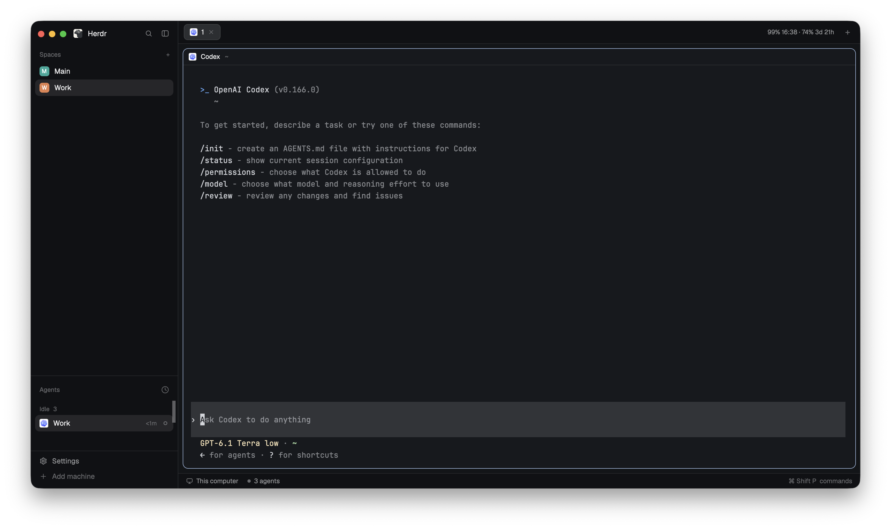

# Codex Limits for Herdr Desktop

See your remaining Codex usage in the Herdr Desktop tab bar. The display refreshes every minute and appears when the active tab contains a Codex agent.



For example, `99% 16:38 · 74% 3d 21h` means 99% of the five-hour allowance remains until 16:38 local time, and 74% of the weekly allowance remains until its reset in 3 days and 21 hours.

## Requirements

- macOS and Herdr Desktop with mod support. This mod is based on the built-in tabs mod available on October 30, 2026.
- Python 3 at `/usr/bin/python3` and the Codex CLI available as `codex` in Herdr's PATH.
- A signed-in Codex account that reports both usage limits. The mod reads limits through `codex app-server`.

Windows is not currently supported.

## Automatic installation

Install Herdr Desktop and the Codex CLI, sign in to Codex, and open Herdr. Then run:

```sh
git clone https://github.com/ASSAH335/Herdr-Codex-Limits.git
cd Herdr-Codex-Limits
sh install.sh
```

The installer backs up any existing `usage-tabs` mod and `usage-layout.json`, installs and checks the mod, then activates the layout. To install without switching layouts, run `sh install.sh --no-activate`. If Herdr is closed, start it and activate the layout with:

```sh
herdr-app do layout.switch '{"name":"usage-layout"}'
```

Open a tab with Codex. The limits appear at the right of the tab bar when the data is available.

## Manual installation

1. Download and extract the repository ZIP.
2. In Finder, press **Cmd+Shift+G**, enter `~/.config/herdr-app/`, and open the `mods` folder.
3. Copy the extracted `usage-tabs` folder into `mods`. Back up any existing folder with that name first.
4. Copy `usage-layout.json` to `~/.config/herdr-app/layouts/`. Back up any existing file with that name first.
5. With Herdr running, check the mod and activate the layout:

   ```sh
   herdr-app check "$HOME/.config/herdr-app/mods/usage-tabs"
   herdr-app do layout.switch '{"name":"usage-layout"}'
   ```

   The first command should print `check passed`.

## Troubleshooting

Check whether Codex returns usage data, and inspect Herdr for errors:

```sh
/usr/bin/python3 -B "$HOME/.config/herdr-app/mods/usage-tabs/usage.py"
herdr-app status
```

If the first command produces no output, check that `codex` is available, that you are signed in, and that both limits are available. Errors in `herdr-app status` may indicate a compatibility issue with your Herdr version. This mod displays Codex limits; it does not support Claude or other agents.

## Uninstall

Restore the standard layout:

```sh
herdr-app do layout.switch '{"name":"main"}'
```

You can then remove `~/.config/herdr-app/mods/usage-tabs` and `~/.config/herdr-app/layouts/usage-layout.json`. Your Codex tabs and personal settings are not removed. The included layout is a copy of the standard layout and does not carry over personal interface customizations.
